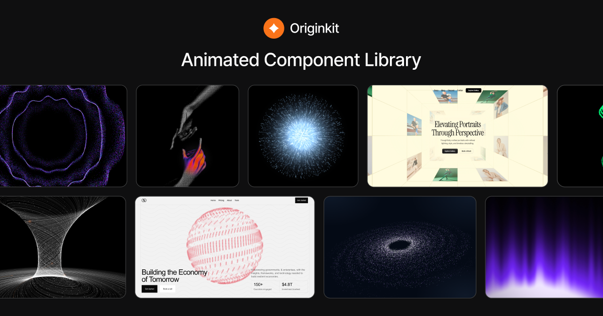
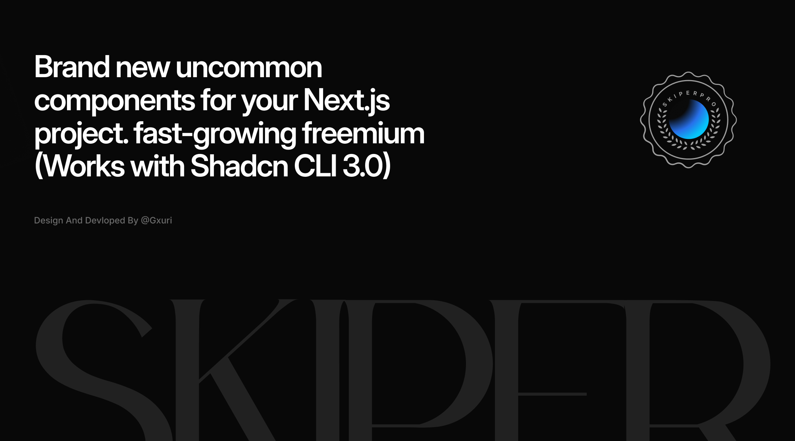
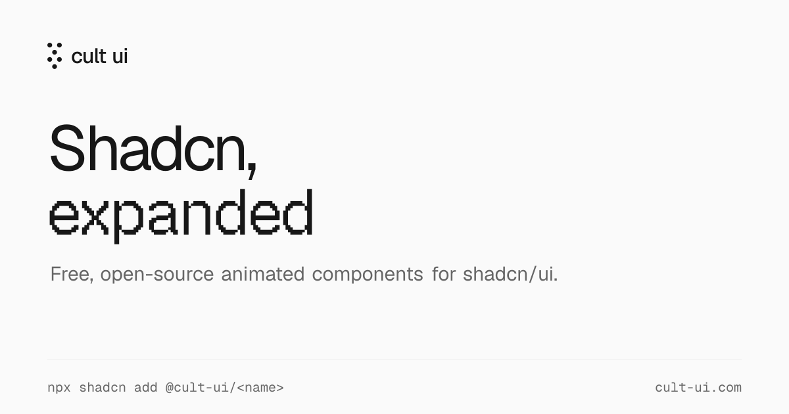

# Bibliotecas de UI animadas

🇺🇸 [Read in English](README.en.md)

Três bibliotecas de componentes para dar mais vida a interfaces modernas, cada uma com uma proposta diferente.

---

## [Originkit](https://www.originkit.dev/)

Biblioteca focada em componentes animados para sites modernos.

O grande diferencial é a flexibilidade: dá para copiar o código, usar direto no Framer, instalar via CLI ou integrar por MCP com ferramentas como Claude Code, ChatGPT, Lovable e Cursor. É a opção mais alinhada ao conceito de vibecoding com IA.

---

## [Skiper UI](https://skiper-ui.com/)

Reúne componentes menos comuns e mais experimentais para projetos com Next.js e shadcn/ui.

Se destaca por interações sofisticadas, efeitos de hover, transições, interfaces inspiradas em produtos conhecidos e componentes que fogem do visual SaaS genérico.

---

## [Cult UI](https://www.cult-ui.com/)

Funciona como uma expansão do ecossistema shadcn/ui, com componentes animados, efeitos, widgets, blocos e padrões para interfaces modernas.

Como os componentes entram no projeto como código-fonte, você pode modificar tudo e incorporá-los ao seu próprio design system, sem ficar preso a uma dependência fechada.

---

Imagens: material de divulgação de cada projeto, com links para os sites oficiais.
